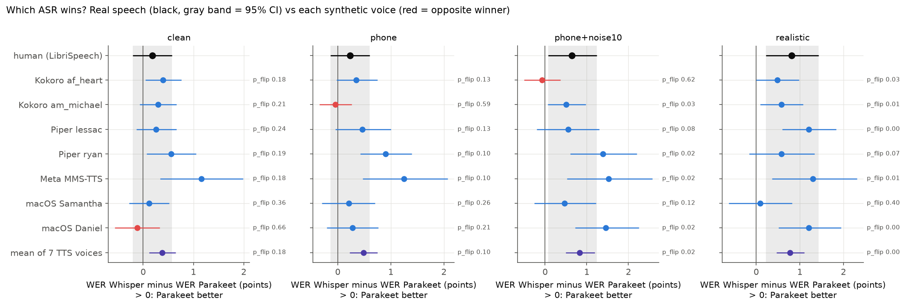
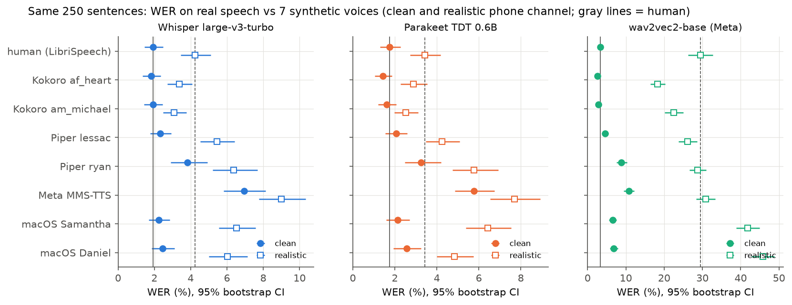
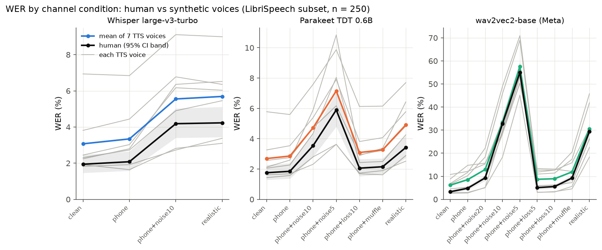
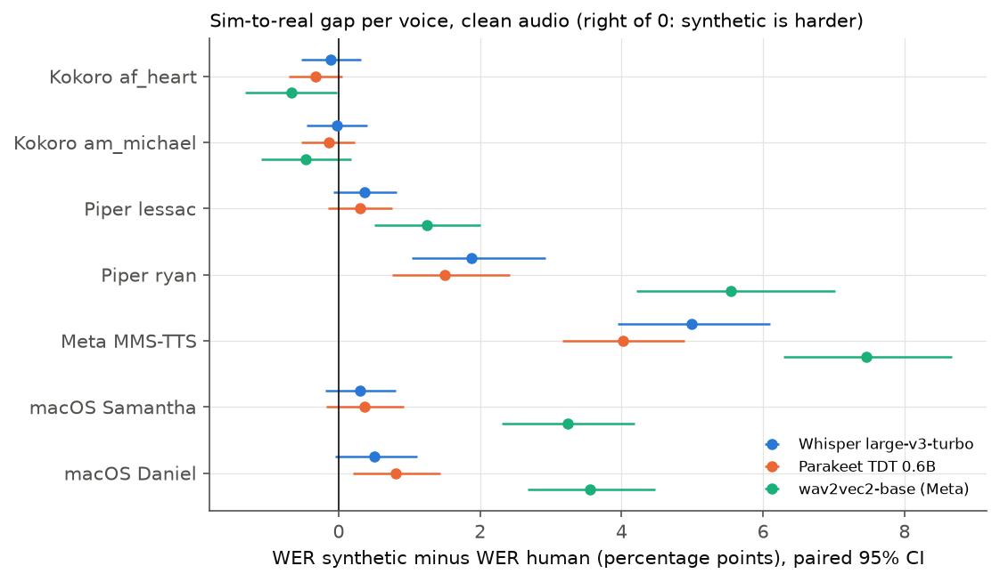
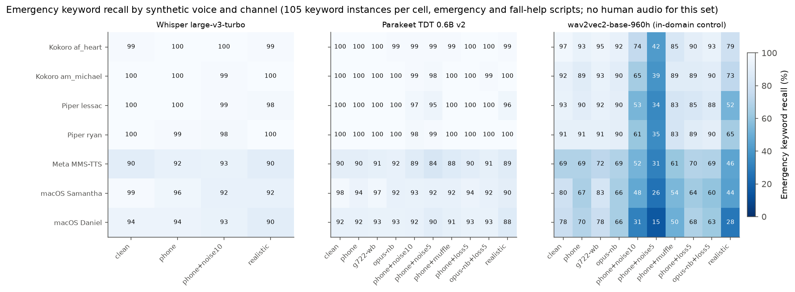
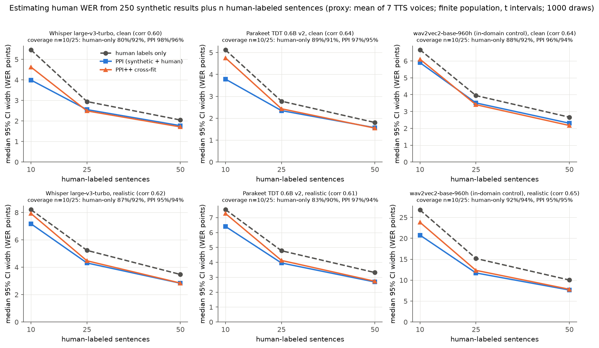
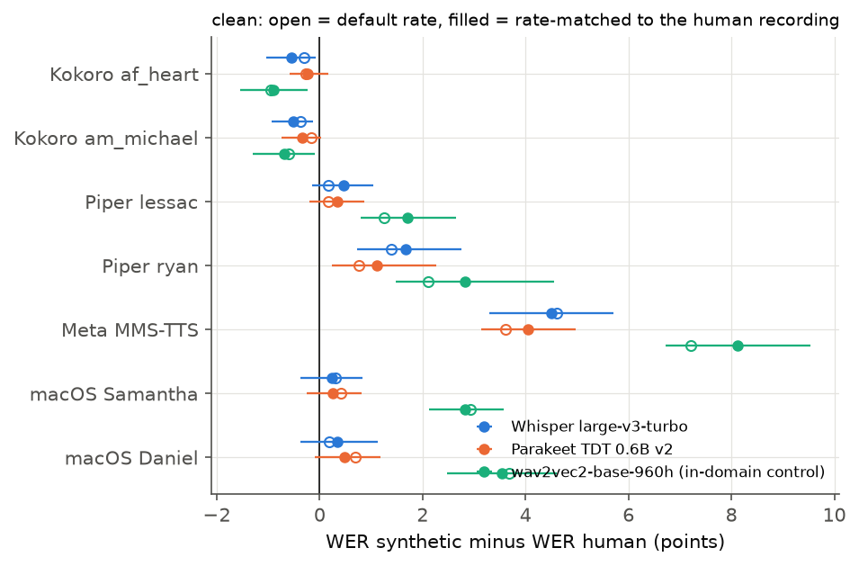

# voice-sim2real

[](https://github.com/AmirK-S/voice-sim2real/actions/workflows/tests.yml)

**Do synthetic callers change which model wins?** A local, reproducible measurement of one slice of the sim-to-real gap in voice-agent evaluation: the same scripts read by real people and by 7 TTS voices, sent through simulated phone channels, transcribed by 3 public ASR models. About 74,000 scored transcriptions.

**TL;DR**
- No single synthetic voice confidently flipped the winner between two close models. **Averaging voices gave a winner on noisy channels that the human sample is too small to confirm or rule out.** The v2 interval for that average was too narrow because it held the voices fixed. (Corrected 13/10/2026: the earlier wording, "confident where real speech shows no winner", overstated it; see `results/followups/literature_checks`.)
- The voice changes **how big** a difference looks: from 0.37x to 3.72x the real gap (descriptive extremes over many cells, all in pairs with the in-domain wav2vec2 control).
- Some voices hide **about half the damage** that noise does to real speech.
- Whisper produced text on **33 of 100 clips of pure noise**.
- About 25 real recordings plus synthetic runs (PPI) give a valid estimate of real-speech WER, with a tighter interval than the recordings alone.

One-page summary: [`REPORT.md`](REPORT.md). Every number, CI and caveat: [`results/FINDINGS.md`](results/FINDINGS.md).



## Why

Voice agents are often tested with simulated callers: a script, a TTS voice, an automated run. Simulated callers do not sound or behave like real callers, so a change can look better in the lab than in production. This repo measures the acoustic half of that gap with public models standing in for the agent's ear:

- does the WER change depending on which synthetic voice reads the script?
- does the lab pick a different winner between two ASR models than real speech does (a decision flip)?
- does the lab estimate the cost of a phone channel (codec, noise, packet loss) correctly?
- how often are emergency keywords ("bleeding", "not breathing", "chest pain", "help", ...) missed, per voice and per channel?

It does not measure caller behaviour (panic, hesitation, off-script answers, talking over the agent), a streaming pipeline (VAD, endpointing, barge-in) or real emergency calls. "Human" here means LibriSpeech read speech.

## Quickstart

Apple Silicon Mac, `uv`, `ffmpeg`, system libopus (`brew install opus`). Python 3.12 is pinned.

```
uv sync                                          # install dependencies (uv.lock)
uv run python scripts/smoke_test.py              # end-to-end check on a few clips
uv run python scripts/01_make_corpus.py          # 250 LibriSpeech sentences x (human + 7 TTS), 122 caller scripts x 7 TTS
uv run python scripts/01b_rate_matched.py        # TTS re-synthesized at the human speaking rate
uv run python scripts/02_channel_selftest.py     # channel checks (G.711, levels, SNR, loss and concealment, Opus, G.722)
uv run python scripts/03_asr_selftest.py         # ASR checks
uv run python scripts/04_run_experiment.py       # full grid, cached and resumable
uv run python scripts/05_analyze.py              # tables, figures, summary.json
uv run --with pytest python -m pytest tests      # stats unit tests
```

Useful variants of step 4: `--model whisper --conditions clean,realistic` runs one model on a subset, `--group rate` runs the rate-matched voices, `--noise-only` runs the hallucination check on pure noise, `--merge-only` rebuilds `results/utterances.csv` from the transcript shards. `scripts/reproduce.sh` (or `make reproduce`) runs the exact published grid.

Data goes to `data/` (gitignored): LibriSpeech test-clean (openslr.org, CC BY 4.0), ESC-50 noise (GitHub, CC BY-NC 3.0), Piper voices. Models live in the Hugging Face cache.

The same steps are available as `make setup`, `make smoke`, `make corpus`, `make run`, `make analyze` and `make test`.

## What is in the experiment

| Part | What |
|---|---|
| Human speech | 250 LibriSpeech test-clean sentences, 40 speakers |
| Caller scripts | 122 written scripts: 64 emergency, 16 fall needing help, 16 fall but fine, 26 non-emergency. TTS only, no human audio |
| TTS voices (7) | Kokoro af_heart, am_michael; Piper lessac, ryan; Meta MMS-TTS eng; macOS `say` Samantha, Daniel |
| ASR models (3) | Whisper large-v3-turbo (MLX), Parakeet TDT 0.6B v2 (MLX), wav2vec2-base-960h (in-domain control: trained on LibriSpeech) |
| Clip preparation | edge silence trimmed, 250 ms lead and trail, active level -26 dBov, -65 dBFS noise floor |
| Channels (10) | clean; phone (8 kHz, handset filter, G.711 mu-law); G.722 wideband; Opus narrowband about 10 kb/s; phone + ESC-50 noise at 10 and 5 dB SNR measured after the line; muffled pendant-like audio; 5 % packet loss with G.711 Appendix I-style concealment; Opus with 5 % loss and real libopus concealment; "realistic" (street noise 10 dB, phone line, 3 % bursty loss) |
| Metrics | corpus WER (Whisper English normalizer), gap vs human on the same sentences, channel damage, emergency keyword recall, call-level detection, false alarms, text produced on pure noise |
| Statistics | speaker-cluster bootstrap CIs, difference-in-differences test for lab-vs-reality decisions with Holm correction, Benjamini-Hochberg on large tables, exact McNemar for keyword detection, rule of three for zero-miss claims, prediction-powered inference (PPI, PPI++) |

The full run is 73,746 scored transcriptions. Whisper ran 4 of the 10 channels (clean, phone, phone+noise10, realistic) for GPU-time reasons; Parakeet and wav2vec2 ran all 10.

## Headline results

All numbers in WER percentage points ("points") with 95 % CIs; details in `results/FINDINGS.md`.

| Question | Result |
|---|---|
| Does a single synthetic voice flip the winner between Whisper and Parakeet? | No confident flip. Real speech only has a winner on clean audio (Parakeet by 0.37 [0.12, 0.67]). No voice's lab-vs-reality difference survives Holm correction across 28 decisions. |
| Does averaging 7 voices help? | It picks the right winner on clean audio, but declares Parakeet significantly better on all 3 phone and noisy conditions where real speech shows no winner. Averaging shrinks the CI, not the bias. |
| Large gaps (Whisper or Parakeet vs wav2vec2) | Winner never flips, but the lab's gap ranges from 0.37x to 3.72x the real gap. Realistic channel: real Whisper vs wav2vec2 gap 21.7 points; lab says 9.6 (Kokoro) to 35.8 (macOS Daniel). |
| Synthetic vs human WER, clean audio | Kokoro -0.2 to -0.4 points (easier than humans), Piper ryan +0.8 to +1.4, Meta MMS +3.6 to +4.6 (harder). Worst voice / best voice: about 4x. |
| Cost of noise | Kokoro shows about half the WER increase that the same noise causes on human speech (Whisper phone+noise10: real +2.13, Kokoro error -1.18 [-2.11, -0.31]). |
| Emergency keyword recall, realistic channel | Whisper 95.5 %, Parakeet 94.6 %, wav2vec2 55.2 %. Call-level misses: 7 and 9 of 546 renderings for Whisper and Parakeet. |
| Text on pure noise (100 clips) | Whisper produced text on 33 ("thank you" 26 times), Parakeet 2, wav2vec2 21. |
| PPI | About 25 human recordings plus TTS runs of the same scripts give a valid interval on the real-speech WER, 9 to 23 % narrower than the 25 human recordings alone. |

## Charts

| | |
|---|---|
|  |  |
|  |  |
|  |  |
|  | |

Tables behind every number: `results/tables/` (18 CSV files) and `results/summary.json`.

## Limitations

- **Behaviour is absent.** Every voice reads the identical script. The behavioural half of the gap is probably the larger one, and it is not here.
- **The human baseline is in-domain.** LibriSpeech is wav2vec2's training domain and likely part of the others' training data. Gap magnitudes against human speech are upper bounds; an out-of-domain human set (real phone recordings of the caller scripts, or FLEURS) is the fix.
- **Offline ASR on single utterances.** No streaming, endpointing, barge-in or turn-taking.
- **Simulated channels.** The handset filter approximates P.48 and the concealment is modelled on G.711 Appendix I, not bit-exact. ESC-50 noise approximates street and room noise.
- **Partial grid.** Whisper ran 4 of 10 channels; rate-matched voices ran on clean audio only.
- **Nobody listened to the clips.** TTS rendering errors (MMS, "hell" for "help" on macOS Daniel) are inferred from transcripts and a shared-error filter.
- **Keyword recall has no human reference.** The caller scripts exist only as TTS audio, so keyword comparisons are between voices and channels.
- **Licence.** ESC-50 is CC BY-NC.

## How to extend

The pipeline is three plain functions, so each piece can be swapped.

**Your own TTS.** Add a branch in `synthesize()` in `src/sim2real/tts.py` that returns 16 kHz mono float32 audio, and add its `engine:voice` id to `VOICES`. Then rerun steps 1, 4 and 5. Recorded human audio of the caller scripts can enter the same way, as a voice that loads files instead of synthesizing.

**Your own ASR.** Write a function `my_asr(audio16k: np.ndarray) -> str` in `src/sim2real/asr.py`, add its id to `MODELS` and to the `ASR` dict (and an alias in `MODEL_ALIASES`). Transcripts are cached by audio hash, so only new clips are decoded.

**Your own channel.** Add an entry to `CONDITIONS` in `src/sim2real/channel.py`: a function `(audio16k, seed, meta) -> audio16k`. The seed comes from the sentence id, so every voice gets the same noise bed and loss pattern and comparisons stay paired.

**Your own agent.** Replace the ASR step with a call to your stack (for example, stream the channel-processed audio into it and keep the final transcript, the detected intent or the escalation decision), and score that output instead of WER. The statistics in `src/sim2real/stats.py` (paired and cluster bootstrap, difference in differences, McNemar, rule of three, PPI) take plain arrays and do not depend on ASR.

**Your own scripts.** The caller set lives in `src/sim2real/data.py` (`emergency_callers()`, `KEYWORDS`). Keyword recall and call-level detection use that keyword list.

## Project layout

```
src/sim2real/   tts.py (voices), channel.py (phone line, noise, loss, codecs), asr.py (models, cache),
                stats.py (bootstrap, DiD, McNemar, rule of three, PPI), data.py (corpus, caller scripts)
scripts/        numbered pipeline steps, self-tests, reproduce.sh
results/        FINDINGS.md, tables/ (CSV), figures/ (PNG), summary.json
tests/          statistics unit tests (run in CI)
```

## Troubleshooting

If `import sim2real` fails under `uv run`, macOS may have flagged the editable `.pth` file in `.venv` as hidden. The scripts add `src/` to `sys.path` themselves; `chflags nohidden .venv/lib/python3.12/site-packages/*.pth` also fixes it.

## Licences

Code: MIT. LibriSpeech: CC BY 4.0. ESC-50: CC BY-NC 3.0 (non-commercial; mention it if results are shared). Whisper English spelling map vendored from openai-whisper (MIT).
